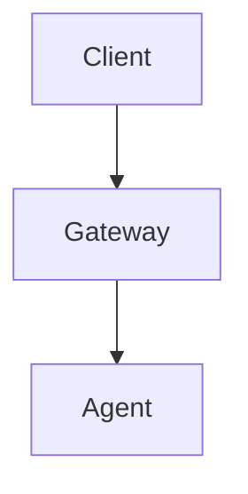
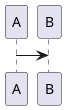

# Markdown fixture

手写一段正文，用来验证 M4 的转换结果。同一份内容在 pi 里也适用：让模型输出同样的结构即可。

## 标准 mermaid（交给 pi 内置渲染器）



## 方言 fence（pi-ds-tui 自己渲染）

```statediagram
[*] --> Idle
Idle --> Running: start
Running --> Idle: stop
Running --> [*]
```

```classdiagram
class Animal {
  +String name
  +speak()
}
class Dog
Animal <|-- Dog
```

```erdiagram
CUSTOMER ||--o{ ORDER : places
ORDER ||--|{ LINE-ITEM : contains
```

```sequencediagram
Alice->>Bob: hello
Bob-->>Alice: hi
```

## 未知 fence（必须原样保留）



## 表格与公式（由 pi 原生渲染，转换器不得改写）

| 芯片 | 优先级 | 说明 |
| --- | --- | --- |
| context | 1 | 永不丢弃 |
| tokens | 2 | 窄屏先丢 |
| cost | 3 | 最不重要 |

行内公式 $e^{i\pi} + 1 = 0$，块级公式：

$$
\int_0^1 x^2 \, dx = \frac{1}{3}
$$

## 提示标签（转换器不处理，原样显示）

<context>
这一段是模型内部的上下文整理。pi-ds-tui 不改写它，正文保持模型写入的样子。
</context>

<commit_analysis>
这一段同样原样保留。
</commit_analysis>

上面的标签块应该完整可见。

## 代码块内的同名标签（必须原样保留）

```ts
// <context> 在代码里是普通文本
const html = '<context>keep me</context>'
```

## 超长行（宽度安全）

abcdefghijklmnopqrstuvwxyz0123456789ABCDEFGHIJKLMNOPQRSTUVWXYZ-abcdefghijklmnopqrstuvwxyz0123456789

## 未闭合的方言 fence（原样保留，不额外吞并）

```statediagram
[*] --> Idle
